# Kiến trúc cụm talos-kvm

Người thực hiện: Hưng, Phúc. Cập nhật: 29/10/2026.

Cụm Kubernetes on-premise trên một máy KVM (kvm-host2), vận hành theo GitOps. Code đi từ GitHub qua Jenkins, được quét và ký, rồi Argo CD triển khai blue-green. Cụm chỉ kéo image của ứng dụng từ Harbor nội bộ và chỉ chạy image có chữ ký của Jenkins.

Khi có thay đổi hạ tầng hoặc cấu hình, sửa file này cùng commit và ghi thêm vào [nhat-ky-thay-doi.md](nhat-ky-thay-doi.md).

## 1. Bộ sơ đồ

Sáu hình, đọc từ tổng quát đến chi tiết; mỗi hình trả lời một câu hỏi. Màu theo nhóm: xanh ngọc là nền tảng, cam là bảo mật, xanh lá là ứng dụng, xanh dương là danh tính, tím là giám sát; khung nét đứt là dịch vụ bên ngoài. Trong các hình luồng, nét xanh chuyển động chỉ hướng dữ liệu, nét cam đứt là Kyverno kiểm chữ ký.

### 1.1 Bối cảnh: hệ thống nói chuyện với ai

### 1.2 Hạ tầng vật lý: cái gì chạy trên máy nào

Ba VM Talos dùng chung một ổ HDD của host2 (nút thắt IO). Volume dùng local-path nên pod có dữ liệu bị ghim vào đúng một worker.

### 1.3 Thành phần trong cụm: ai gọi ai

### 1.4 Luồng đưa code lên production

### 1.5 Backup hằng ngày

### 1.6 Phụ thuộc bên ngoài

Nguồn các hình là file text D2 trong [so-do/](so-do/) (`chung.d2` chứa màu và kiểu dùng chung). Sửa xong thì xuất lại, ví dụ `d2 docs/so-do/ha-tang.d2 docs/so-do/ha-tang.svg`. Logo lấy từ CNCF artwork và Simple Icons, được nhúng thẳng vào SVG.

## 2. Hạ tầng

Sơ đồ: mục 1.2.

| VM | IP | vCPU | RAM | Tên node | Ghi chú |
|---|---|---|---|---|---|
| cp1 | 10.10.10.11 | 2 | 3,5 GB | talos-w9b-tsv | control plane duy nhất từ 20/10 |
| w1 | 10.10.10.21 | 2 | 4,5 GB | talos-hdl-7jo | DB keycloak-db cũ ghim ở đây |
| w2 | 10.10.10.22 | 2 | 4,5 GB | talos-iv6-z5m | Harbor, Grafana ghim ở đây |
| cp2, cp3 | .12, .13 | | | | tắt, giữ đĩa để bật lại khi cần HA |

- Node chạy Talos Linux, không có SSH, quản trị bằng API `talosctl`.
- Dịch vụ truy cập qua HAProxy :443 trên host2 rồi vào Traefik. Tên miền `*.talos.internal`, chứng chỉ do CA nội bộ (cert-manager) cấp. Laptop cần thêm tên vào file hosts ([truy-cap.md](truy-cap.md)).
- Host2 ra Internet qua captive portal của văn phòng. Host2 bị tắt cuối ngày (T2/T4 lúc 10:30); bật/tắt cụm theo runbook.

## 3. Luồng đưa code lên production

1. **Push code** lên GitHub (talos-demo-app). Jenkins kiểm tra repo 5 phút một lần.
2. **Jenkins quét, build và ký**: gitleaks quét toàn bộ lịch sử Git, test có coverage, govulncheck, gosec, quality gate SonarQube; build image amd64 + arm64, đẩy lên GHCR một lần; Trivy quét đúng digest vừa đẩy; SBOM CycloneDX; ký cosign. Cổng nào lỗi thì dừng, không có image được ký.
3. **Jenkins sửa `newTag`** trong `apps/demo-app/kustomization.yaml` của repo này và push.
4. **Argo CD đồng bộ** commit mới vào Rollout của demo-app. Mọi thay đổi trong cụm đi qua Git; sửa tay sẽ bị self-heal đưa về.
5. **Harbor replicate** từ GHCR 10 phút một lần, kèm chữ ký cosign. Cần nhanh thì bấm Replicate tay (Harbor → Replications → `ghcr-demo-app`).
6. **Blue-green**: pod preview kéo image từ `harbor.talos.internal/talos/talos-demo-app`; Kyverno từ chối nếu image không có chữ ký của Jenkins. Preview phải qua smoke test, phân tích tỉ lệ lỗi và quét ZAP rồi mới nhận traffic. Bản cũ giữ thêm 10 phút để quay lại nhanh.

Đo ngày 28/10: từ lúc push tới lúc bản mới nhận traffic khoảng 12 phút (pipeline khoảng 6 phút, blue-green khoảng 6 phút). Kéo image từ Harbor 5 đến 7 giây.

GitHub Actions và GitLab CE vẫn build cùng app để so sánh, nhưng chỉ tạo image `sha-*` không ký và không deploy.

## 4. Thành phần trong cụm

18 ứng dụng Argo CD theo mô hình app-of-apps: `bootstrap/root.yaml` apply tay một lần, app `root` quản lý các app còn lại trong `argocd-apps/`.

| Nhóm | App Argo CD | Chart / phiên bản | Vai trò |
|---|---|---|---|
| Nền tảng | root | | app-of-apps |
| | traefik | traefik 42.0.0 | ingress |
| | cert-manager, cert-manager-issuers | cert-manager v1.21.2 | chứng chỉ từ CA nội bộ `talos-internal-ca` |
| | sealed-secrets | 2.20.0 | secret mã hóa nằm trong Git |
| | local-path | | lưu trữ trên đĩa worker |
| | descheduler | 0.37.0 | cân bằng lại pod giữa w1 và w2 |
| | argo-rollouts | 2.43.8 | blue-green và phân tích |
| Bảo mật | kyverno | 3.9.1 (Kyverno 1.19) | ImageValidatingPolicy: chỉ nhận image ký bằng khoá Jenkins, webhook chỉ ở ns demo |
| | vault | 0.34.1 (Vault 2.0) | secret của ứng dụng, tự unseal bằng GCP KMS, audit log |
| | external-secrets | 2.14.0 | đưa secret từ Vault vào Secret của pod |
| Registry | harbor | 1.19.2 (Harbor 2.15) | bản sao image và chữ ký trong mạng nội bộ, đăng nhập Keycloak |
| Danh tính | keycloak | keycloakx 7.4.0 | SSO OIDC/SAML, DB trên Supabase |
| | keycloak-db | | DB cũ giữ để lùi, gỡ sau 06/11 |
| | oauth2-proxy | | đăng nhập Keycloak trước Prometheus, Alertmanager |
| | headlamp | 0.45.0 | giao diện cụm |
| Giám sát | monitoring | kube-prometheus-stack 92.2.0 | Prometheus, Alertmanager, Grafana |
| Ứng dụng | demo-app | | app Go mẫu, Rollout blue-green |

Talos v1.14.2, Kubernetes v1.37.1, CNI Flannel.

## 5. Bảo mật

- **Chuỗi cung ứng**: mọi cổng của Jenkins đã thử bằng commit hoặc image lỗi cố ý. Image không ký bị Kyverno từ chối, kể cả khi lấy từ Harbor. Khoá công khai cosign ở `platform/cosign/cosign.pub`.
- **Secret**: hạ tầng dùng Sealed Secrets. Biến môi trường của ứng dụng nằm ở Vault (`kv/demo/demo-app`), External Secrets đưa vào pod; đổi giá trị không cần commit.
- **Đăng nhập**: Keycloak SSO cho Grafana, Argo CD, Headlamp, Vault, Jenkins, GitLab, SonarQube, Harbor. Quyền theo nhóm `talos-admins`, `talos-viewers`. Mỗi công cụ giữ một tài khoản dự phòng khi Keycloak hỏng.
- **Mạng**: dịch vụ chỉ mở trong LAN qua HAProxy; DB của Harbor có NetworkPolicy.

## 6. Vận hành

- **Backup** hằng ngày 16:45 trên host2 (ngoài cụm): snapshot etcd, dump DB Keycloak (Supabase), dump DB Harbor, snapshot Vault; gom thành một gói mã hóa GPG, đẩy lên Backblaze B2. Lỗi bước nào thì báo Telegram. Đã thử giải mã gói backup; khôi phục Vault từ snapshot chưa diễn tập.
- **Cảnh báo**: Prometheus/Alertmanager báo Telegram khi cụm còn sống (demo-app, ExternalSecret, Keycloak, `VaultNotReady`). Watchdog trên host2 và healthchecks.io báo khi cả cụm chết.
- **Khởi động lạnh**: 9 phút 29 giây từ lúc bật cp1 tới khi mọi app Healthy (đo 28/10).
- **Runbook**: bật/tắt hằng ngày, kiểm tra backup, xử lý các lỗi đã gặp (ngoài repo, file `talos-kvm-runbook.md`).

## 7. Giới hạn đã biết

- Một ổ HDD dùng chung cho etcd, Prometheus và kéo image: IO là giới hạn chính.
- Chỉ 1 control plane để tiết kiệm RAM: mất cp1 thì mất API cho tới khi bật lại.
- Phụ thuộc Internet qua captive portal: mất mạng thì Vault không unseal (cần KMS), Keycloak không vào được DB (Supabase), Argo CD không đọc được Git.
- Harbor và các volume có trạng thái ghim vào một worker: worker đó tắt thì dịch vụ đó ngừng.
