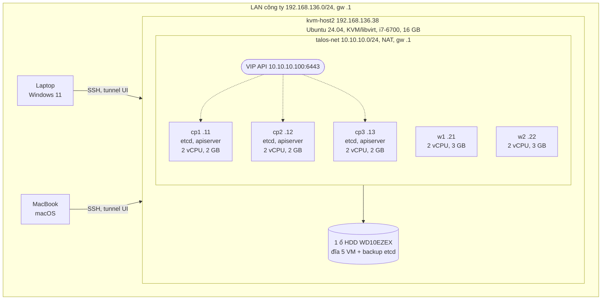
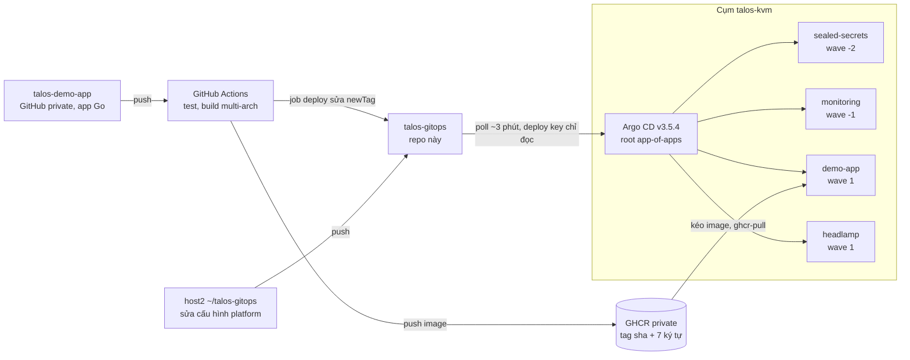
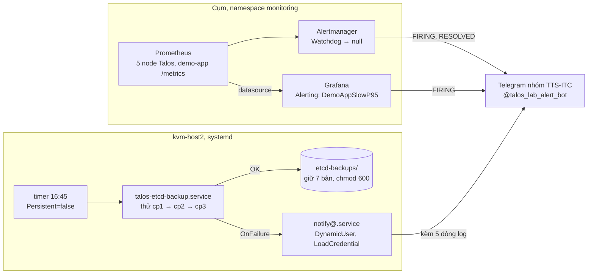

# Kiến trúc cụm talos-kvm

Người thực hiện: Hưng, Phúc. Cập nhật: 16/10/2026.

Lab Kubernetes HA trên Talos Linux: 3 control plane + 2 worker chạy trên một máy KVM (kvm-host2), API qua VIP `10.10.10.100:6443`, triển khai bằng GitOps (Argo CD), có giám sát, cảnh báo Telegram và backup etcd hằng ngày.

Khi có thay đổi hạ tầng hoặc cấu hình, sửa file này cùng commit và ghi thêm vào [nhat-ky-thay-doi.md](nhat-ky-thay-doi.md).

## 1. Hạ tầng vật lý và mạng

- Mọi thành phần của cụm nằm trên kvm-host2. Mạng `talos-net` là NAT, máy trên LAN không vào thẳng được `10.10.10.x` (xem [truy-cap.md](truy-cap.md)).
- VIP là địa chỉ Layer 2 do một control plane giữ tại một thời điểm, tự chuyển khi node đó mất. Trong cụm dùng thêm KubePrism (cân bằng tải API cục bộ trên mỗi node).
- Đồng hồ cụm lấy từ host2 qua KVM PTP nên cụm vẫn lên khi host chưa có Internet.
- Host2 bị tắt khoảng 17:00 mỗi ngày; cụm được tắt/bật có kiểm soát theo runbook.

| VM | IP | vCPU | RAM | Tên node |
|---|---|---|---|---|
| cp1 | 10.10.10.11 | 2 | 2 GB | talos-w9b-tsv |
| cp2 | 10.10.10.12 | 2 | 2 GB | talos-q8k-x6o |
| cp3 | 10.10.10.13 | 2 | 2 GB | talos-0qf-cqf |
| w1 | 10.10.10.21 | 2 | 3 GB | talos-hdl-7jo |
| w2 | 10.10.10.22 | 2 | 3 GB | talos-iv6-z5m |

## 2. Luồng GitOps và CI/CD

- Không `kubectl apply` tay cho ứng dụng; mọi thay đổi đi qua repo này. Chỉ `bootstrap/root.yaml` được apply tay một lần.
- Wave đảm bảo sealed-secrets lên trước để giải mã secret cho monitoring và demo-app.
- CI dùng deploy key riêng có quyền ghi để sửa tag; Argo CD đọc repo bằng deploy key chỉ đọc.

## 3. Giám sát, cảnh báo và backup

- Hai đường cảnh báo trong cụm đã thử đầu-cuối (Alertmanager: FIRING và RESOLVED; Grafana: FIRING).
- Rule riêng cho app: `DemoAppDown`, `DemoAppHighErrorRate`, `DemoAppSlowP95` (p95 > 0,5 s trong 2 phút).
- Backup chạy ngoài cụm nên vẫn báo được khi cụm có vấn đề. Prometheus chưa thu metrics của chính host2.

## 4. Thành phần và phiên bản

| Lớp | Thành phần | Phiên bản / cấu hình |
|---|---|---|
| Host | kvm-host2 | Ubuntu 24.04, KVM/libvirt, i7-6700, 16 GB, 1 HDD WD10EZEX, `vm.swappiness=10` |
| VM | 3 CP + 2 worker | 2 vCPU mỗi VM, `host-passthrough`, CP 2 GB, worker 3 GB (tổng 12 GB cho VM), disk virtio `cache=none,io=native` |
| OS cụm | Talos Linux | v1.14.2, không SSH, quản trị bằng API `talosctl` |
| Kubernetes | control plane | v1.37.1, etcd 3 member (heartbeat 500 ms, election 5000 ms), VIP L2, KubePrism |
| Mạng | CNI | Flannel |
| Thời gian | TimeSyncConfig | KVM PTP `/dev/ptp_kvm`, `bootTimeout: 2m`; host2 NTP `time.cloudflare.com` |
| GitOps | Argo CD | v3.5.4 (chart 10.10.1), app-of-apps |
| Secret | Sealed Secrets | chart 2.20.0, controller 0.40.0 |
| Giám sát | kube-prometheus-stack | chart 92.2.0: Prometheus, Alertmanager, Grafana (request 384Mi, limit 1Gi) |
| Dashboard | Headlamp | chart 0.45.0 |
| Ứng dụng | demo-app (Go) | 2 replica, image distroless nonroot, endpoint `/healthz`, `/readyz`, `/metrics` |
| Công cụ | trên host2 | talosctl 1.14.2, kubectl 1.37.1, helm 4.3.0, kubeseal 0.40.0 |
