# Kiến trúc cụm talos-kvm

Người thực hiện: Hưng, Phúc. Cập nhật: 06/11/2026.

Cụm Kubernetes on-premise trên một máy KVM (kvm-host2), thêm một worker trên Google Cloud nối bằng KubeSpan, vận hành theo GitOps. Code đi từ GitHub qua Jenkins, được quét và ký, rồi Argo CD triển khai blue-green. Cụm chỉ kéo image của ứng dụng từ Harbor nội bộ và chỉ chạy image có chữ ký của Jenkins.

Khi có thay đổi hạ tầng hoặc cấu hình, sửa file này cùng commit và ghi thêm vào [nhat-ky-thay-doi.md](nhat-ky-thay-doi.md).

## 1. Bộ sơ đồ

Sáu hình, đọc từ tổng quát đến chi tiết; mỗi hình trả lời một câu hỏi. Màu theo nhóm: xanh ngọc là nền tảng, cam là bảo mật, xanh lá là ứng dụng, xanh dương là danh tính, tím là giám sát; khung nét đứt là dịch vụ bên ngoài. Trong các hình luồng, nét xanh chuyển động chỉ hướng dữ liệu, nét cam đứt là Kyverno kiểm chữ ký.

### 1.1 Bối cảnh: hệ thống nói chuyện với ai

### 1.2 Hạ tầng vật lý: cái gì chạy trên máy nào

Ba VM Talos on-prem dùng chung một ổ HDD của host2 (nút thắt IO: lúc khởi động lạnh 03/11, CPU chờ đĩa 43–64% thời gian). w3 trên GCP có đĩa riêng. Volume dùng local-path nên pod có dữ liệu bị ghim vào đúng một worker. Từ 05/11 có thêm StorageClass `nfs-host2`: PV nằm trên NFS server của host2 (`/srv/nfs/k8s`, ngoài các VM), mount được từ w1 và w2; Harbor registry (image, chữ ký) chạy trên `nfs-host2` từ 05/11. Test Postgres T1–T8 đạt (pod chuyển node giữ dữ liệu, sập khi ghi tự phục hồi, mất NFS 60 s chỉ treo), nhưng fsync qua NFS chậm gấp 4, nên DB (Harbor postgres, Vault) cùng Grafana, Prometheus, VictoriaLogs vẫn dùng local-path. Anh góp ý 05/11: NFS là một server đơn, không HA. Từ 06/11 có **Longhorn** (StorageClass `longhorn`): mỗi worker w1, w2 có thêm đĩa qcow2 20G `vdb` dành riêng, mỗi PV giữ 2 bản sao trên 2 worker. Test L1–L6: rút điện một worker thì Postgres tự lên ở worker kia sau 4:45 với đủ dữ liệu, sập giữa lúc ghi vẫn toàn vẹn, fdatasync 4,7 ms (NFS 51 ms), Velero backup/khôi phục được dữ liệu volume. Giới hạn: 2 bản sao vẫn cùng ổ HDD của host2, chống mất một node chứ không chống mất host2; và memory request của w1, w2 đang 84–95%, nên khi mất một worker, worker còn lại chưa chạy được hết pod (cần rà request). Kế hoạch: chuyển Harbor registry sang Longhorn rồi gỡ NFS (chờ anh duyệt).

### 1.3 Thành phần trong cụm: ai gọi ai

### 1.4 Luồng đưa code lên production

### 1.5 Backup hằng ngày

### 1.6 Phụ thuộc bên ngoài

Nguồn các hình là file text D2 trong [so-do/](so-do/) (`chung.d2` chứa màu và kiểu dùng chung). Sửa xong thì xuất lại, ví dụ `d2 docs/so-do/ha-tang.d2 docs/so-do/ha-tang.svg`. Logo lấy từ CNCF artwork và Simple Icons, được nhúng thẳng vào SVG.

## 2. Hạ tầng

Sơ đồ: mục 1.2.

| VM | IP | vCPU | RAM | Tên node | Ghi chú |
|---|---|---|---|---|---|
| cp1 | 10.10.10.11 | 2 | 3,5 GB | talos-w9b-tsv | control plane duy nhất từ 20/10 |
| w1 | 10.10.10.21 | 2 | 4,5 GB | talos-hdl-7jo | thường chạy Keycloak, Kyverno, Argo CD application-controller (không ghim) |
| w2 | 10.10.10.22 | 2 | 4,5 GB | talos-iv6-z5m | Harbor, Grafana, Vault ghim ở đây (PriorityClass `talos-pinned`) |
| w3 (GCP) | 10.148.0.4 | 2 | 8 GB | w3 | VM GCP e2-standard-2 (asia-southeast1-b), nối cụm bằng KubeSpan (WireGuard) từ 30/10; taint `cloud=gcp:NoSchedule`; ghim Prometheus, VictoriaLogs; ưu tiên (preferred) Alertmanager, argo-rollouts, sealed-secrets, kube-state-metrics, prometheus-operator, Argo CD repo-server và applicationset, job ZAP, job image-scan; không đặt thứ cần `*.talos.internal` lên đây; bật 08:15–17:15 T2–T6 |
| cp2, cp3 | .12, .13 | | | | tắt, giữ đĩa để bật lại khi cần HA |

- Node chạy Talos Linux, không có SSH, quản trị bằng API `talosctl`.
- Dịch vụ truy cập qua HAProxy :443 trên host2 rồi vào Traefik. Tên miền `*.talos.internal`, chứng chỉ do CA nội bộ (cert-manager) cấp. Laptop cần thêm tên vào file hosts ([truy-cap.md](truy-cap.md)).
- Host2 ra Internet qua captive portal của văn phòng. Host2 bị tắt cuối ngày (T2/T4 lúc 10:30); bật/tắt cụm theo runbook.

## 3. Luồng đưa code lên production

1. **Push code** lên GitHub (talos-demo-app). Jenkins kiểm tra repo 5 phút một lần.
2. **Jenkins quét, build và ký**: gitleaks quét toàn bộ lịch sử Git, test có coverage, govulncheck, gosec, quality gate SonarQube; build image amd64 + arm64, đẩy lên GHCR một lần; Trivy quét đúng digest vừa đẩy; SBOM CycloneDX; ký cosign. Cổng nào lỗi thì dừng, không có image được ký.
3. **Jenkins sửa `newTag`** trong `apps/demo-app/kustomization.yaml` của repo này và push.
4. **Argo CD đồng bộ** commit mới vào Rollout của demo-app. Mọi thay đổi trong cụm đi qua Git; sửa tay sẽ bị self-heal đưa về.
5. **Harbor replicate** từ GHCR 10 phút một lần, kèm chữ ký cosign. Cần nhanh thì bấm Replicate tay (Harbor → Replications → `ghcr-demo-app`). Trong lúc chờ, Kyverno từ chối pod mới; Argo CD thử lại khoảng 16 phút (`syncPolicy.retry` của app demo-app) nên tự qua được.
6. **Blue-green**: pod preview kéo image từ `harbor.talos.internal/talos/talos-demo-app`; Kyverno từ chối nếu image không có chữ ký của Jenkins. Preview phải qua smoke test, phân tích tỉ lệ lỗi và quét ZAP rồi mới nhận traffic. Bản cũ giữ thêm 10 phút để quay lại nhanh.

Đo ngày 28/10: từ lúc push tới lúc bản mới nhận traffic khoảng 12 phút (pipeline khoảng 6 phút, blue-green khoảng 6 phút). Kéo image từ Harbor 5 đến 7 giây.

GitHub Actions và GitLab CE vẫn build cùng app để so sánh, nhưng chỉ tạo image `sha-*` không ký và không deploy.

## 4. Thành phần trong cụm

25 ứng dụng Argo CD theo mô hình app-of-apps: `bootstrap/root.yaml` apply tay một lần, app `root` quản lý các app còn lại trong `argocd-apps/`.

| Nhóm | App Argo CD | Chart / phiên bản | Vai trò |
|---|---|---|---|
| Nền tảng | root | | app-of-apps |
| | traefik | traefik 42.0.0 | ingress |
| | cert-manager, cert-manager-issuers | cert-manager v1.21.2 | chứng chỉ từ CA nội bộ `talos-internal-ca` |
| | sealed-secrets | 2.20.0 | secret mã hóa nằm trong Git |
| | local-path | | lưu trữ trên đĩa worker |
| | csi-driver-nfs | csi-driver-nfs 4.13.6 | StorageClass `nfs-host2`: PV trên NFS của host2, driver chỉ chạy trên w1/w2 (từ 05/11) |
| | longhorn | longhorn 1.13.0 | StorageClass `longhorn`: mỗi PV 2 bản sao trên w1 và w2 (đĩa riêng `vdb` 20G mỗi worker), node chết thì pod lên worker kia với đúng dữ liệu (từ 06/11, theo góp ý NFS không HA) |
| | descheduler | 0.37.0 | cân bằng lại pod giữa w1 và w2 |
| | argo-rollouts | 2.43.8 | blue-green và phân tích |
| | admission-policies | | PriorityClass `talos-pinned` cho pod bị ghim; ValidatingAdmissionPolicy `require-memory-request` (Deny + Audit từ 05/11) |
| | gcp-tools | | pod nginx `tunnel-proxy` và Ingress cho Jenkins, GitLab, SonarQube trên GCP (qua tunnel SSH của host2) |
| Bảo mật | kyverno | 3.9.1 (Kyverno 1.19) | ImageValidatingPolicy: chỉ nhận image ký bằng khoá Jenkins, webhook chỉ ở ns demo |
| | vault | 0.34.1 (Vault 2.0) | secret của ứng dụng, tự unseal bằng GCP KMS, audit log |
| | external-secrets | 2.14.0 | đưa secret từ Vault vào Secret của pod |
| | image-scan | | CronJob Trivy 12:30 T2–T6 quét mọi image đang chạy, alert `ImageScanCritical` khi có CVE CRITICAL |
| Registry | harbor | 1.19.4 (Harbor 2.15) | bản sao image và chữ ký trong mạng nội bộ, đăng nhập Keycloak; blob trên NFS host2 (`harbor-registry-nfs`, từ 05/11), DB trên local-path |
| Danh tính | keycloak | keycloakx 7.4.0 | SSO OIDC/SAML, DB trên Supabase |
| | oauth2-proxy | | đăng nhập Keycloak trước Prometheus, Alertmanager, vmui của VictoriaLogs (`logs.talos.internal`, chỉ mở `/select`) |
| | headlamp | 0.45.0 | giao diện cụm |
| Giám sát | monitoring | kube-prometheus-stack 92.2.0 | Prometheus, Alertmanager, Grafana |
| Log tập trung | victoria-logs | victoria-logs-single 0.13.10 | lưu log 7 ngày (tối đa 4 GiB), tra cứu bằng vmui `https://logs.talos.internal/select/vmui/` (LogsQL, theo trường, từ 05/11, anh duyệt); Grafana dashboard "Log tập trung" chỉ để theo dõi (số dòng theo pod, dòng có chữ error) |
| | otel-collector | opentelemetry-collector 0.176.0 | DaemonSet trên cả 4 node, đọc `/var/log/pods`, gắn namespace/pod/container, đẩy OTLP về VictoriaLogs; từ 05/11 tách log JSON thành trường ngay lúc thu (processor `transform/parse`, namespace `demo`, `argocd`), `level` thành severity |
| Backup | velero | velero 12.2.2 (Velero v1.18.4, plugin GCP v1.14.4) | backup object Kubernetes lên bucket GCS `talos-kvm-velero-vtc` 09:30 T2–T6, giữ 30 ngày; ưu tiên chạy trên w3. Từ 06/11 có node-agent (w1, w2) để backup dữ liệu PV Longhorn theo file (kopia) khi chọn `--default-volumes-to-fs-backup`; PV local-path (hostPath) vẫn không backup được |
| Ứng dụng | demo-app | | app Go mẫu, Rollout blue-green |

Talos v1.14.2, Kubernetes v1.37.1, CNI Flannel.

## 5. Bảo mật

- **Chuỗi cung ứng**: mọi cổng của Jenkins đã thử bằng commit hoặc image lỗi cố ý. Image không ký bị Kyverno từ chối, kể cả khi lấy từ Harbor. Khoá công khai cosign ở `platform/cosign/cosign.pub`. Image đang chạy được quét lại mỗi ngày làm việc (app `image-scan`); 02/11 còn 11/48 image có CVE CRITICAL, phân tích ở `TTS_QTDV/design/cve-con-lai-02-11.md`.
- **Secret**: hạ tầng dùng Sealed Secrets. Biến môi trường của ứng dụng nằm ở Vault (`kv/demo/demo-app`), External Secrets đưa vào pod; đổi giá trị không cần commit.
- **Đăng nhập**: Keycloak SSO cho Grafana, Argo CD, Headlamp, Vault, Jenkins, GitLab, SonarQube, Harbor, và Prometheus, Alertmanager, vmui của VictoriaLogs qua oauth2-proxy. Quyền theo nhóm `talos-admins`, `talos-viewers`. Mỗi công cụ giữ một tài khoản dự phòng khi Keycloak hỏng.
- **Mạng**: dịch vụ chỉ mở trong LAN qua HAProxy; DB của Harbor có NetworkPolicy. w3 nối cụm bằng WireGuard (KubeSpan); firewall GCP chỉ mở UDP 51820 và API Talos cho IP công ty.

## 6. Vận hành

- **Backup** hằng ngày 16:45 trên host2 (ngoài cụm): snapshot etcd, dump DB Keycloak (Supabase), dump DB Harbor, snapshot Vault; gom thành một gói mã hóa GPG, đẩy lên Backblaze B2 và Google Cloud Storage (từ 30/10; tài khoản ghi lên GCS chỉ thêm được, không xoá được). Lỗi bước nào thì báo Telegram. Đã thử giải mã gói backup; đã diễn tập khôi phục Vault (29/10) và **toàn cụm lên GCP (05/11): RTO chính 51 phút (demo-app trả 200 từ cụm mới), RTO đầy đủ 54 phút, RPO 6–7 phút**; ước lượng chạy sạch khoảng 40 phút. Từ 03/11 thêm Velero backup object Kubernetes lên GCS (bucket riêng, chặn public, SA chỉ có quyền với object của bucket này); dữ liệu PV vẫn lấy từ gói hằng ngày.
- **Cảnh báo**: Prometheus/Alertmanager báo Telegram khi cụm còn sống (demo-app, ExternalSecret, Keycloak, `VaultNotReady`, `ImageScanCritical`, `VeleroBackupFailed`, `VeleroNoRecentBackup`). Watchdog trên host2 (`host2/bin/talos-watchdog.sh`) và healthchecks.io báo khi cả cụm chết; từ 05/11 watchdog còn kiểm `nfs-server` và dung lượng `/srv` (Harbor registry trên NFS).
- **Log tập trung** (30/10): OpenTelemetry Collector thu log mọi pod, đẩy về VictoriaLogs; tra cứu bằng vmui sau oauth2-proxy (`talos-admins`, `talos-viewers`); Grafana chỉ giữ dashboard theo dõi và datasource cho cảnh báo từ log. Chọn VictoriaLogs thay SigNoz vì SigNoz tự host không có SSO và cần ClickHouse 2–4 GiB RAM; đầu thu là OTLP chuẩn nên đổi backend chỉ cần đổi exporter. Từ 05/11 (anh góp ý tra theo trường như ELK): log JSON (demo-app, Argo CD, Keycloak) được tách thành trường lúc thu, `level` đổi thành `severity_text` chuẩn, tra theo trường và hàm tổng hợp, ví dụ `route:* | stats by (status) count()`; vmui cho tra tự do.
- **Khởi động lạnh**: khoảng 6 phút (5:59, đo 03/11 13:16) từ lúc bật VM tới khi mọi app Healthy, không can thiệp tay, có khởi động lại host2; trước các bản sửa ngày 03/11 là khoảng 11 phút. Keycloak có sidecar `prefetch` đọc tuần tự jar vào page cache nên JVM khởi động 25–29 giây thay vì 98–111 giây; Grafana tắt 16 plugin không dùng. Nút thắt vẫn là ổ HDD: lúc khởi động cụm đọc khoảng 5,5 GB, ba pod về cuối (Keycloak, harbor-jobservice, Grafana) chỉ cách nhau 11 giây. Tắt cụm bằng `talosctl shutdown --force`, control plane trước rồi worker, để pod giữ nguyên node (từ 03/11, xem nhật ký).
- **Tầng GCP bằng Terraform** (`infra/gcp`, từ 06/11): 40 tài nguyên (3 VM, 2 IP, image, 5 firewall, lịch bật/tắt và snapshot, job Scheduler, 3 bucket, 4 SA, 2 custom role, 5 quyền IAM, KMS, Cloud SQL, 9 API) đã import vào state ở bucket `talos-kvm-tfstate-vtc` (versioning), `plan` báo `No changes`. Sửa hạ tầng GCP qua Terraform, không sửa tay trên Console.
- **Runbook**: bật/tắt hằng ngày, kiểm tra backup, xử lý các lỗi đã gặp (ngoài repo, file `talos-kvm-runbook.md`).

## 7. Giới hạn đã biết

- Một ổ HDD dùng chung cho etcd, Prometheus và kéo image: IO là giới hạn chính.
- Chỉ 1 control plane để tiết kiệm RAM: mất cp1 thì mất API cho tới khi bật lại.
- Phụ thuộc Internet qua captive portal: mất mạng thì Vault không unseal (cần KMS), Keycloak không vào được DB (Supabase), Argo CD không đọc được Git, w3 rời cụm (mất Prometheus, log). Tunnel tới GCP có `ConnectTimeout` để tự nối lại khi đăng nhập portal muộn.
- w3 không tới được `*.talos.internal` và host2: thứ cần Keycloak, Harbor phải chạy on-prem. Pod trên w3 dùng DNS qua TCP vì UDP qua đường hầm mất khoảng 1% gói.
- Harbor và các volume có trạng thái ghim vào một worker: worker đó tắt thì dịch vụ đó ngừng.
